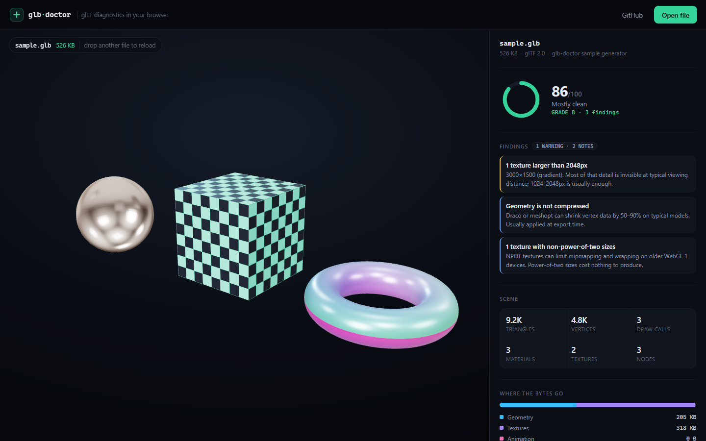

# glb-doctor

**Know what is inside a `.glb` before you ship it.**



[](https://www.npmjs.com/package/glb-doctor)
[](https://github.com/DenisPilich/3DModels/actions/workflows/ci.yml)


glb-doctor reads a binary glTF file and explains what it contains and what it costs: triangles, draw calls, texture sizes, where the megabytes went, and the handful of mistakes that cause most slow 3D on the web.

It is **7.2 kB gzipped, has zero runtime dependencies, and runs in the browser and in Node**. No WASM, no workers, no upload, no build step.

**[Live demo](https://denispilich.github.io/3DModels/?sample)** · **[npm](https://www.npmjs.com/package/glb-doctor)** · **[source](https://github.com/DenisPilich/3DModels)** · `npm install glb-doctor`

```ts
import { diagnose } from 'glb-doctor'

const report = diagnose(await file.arrayBuffer())

report.health.score        // 86
report.health.grade        // 'B'
report.scene.triangles     // 9228
report.cost.textures       // 317704 bytes
report.warnings.map((w) => w.title)
// [ '1 texture larger than 2048px',
//   'Geometry is not compressed',
//   '1 texture with non-power-of-two sizes' ]
```

---

## Why another glTF tool?

The existing options are good, but they are not what you reach for in a browser tab:

- `gltf-validator` is a spec validator. It tells you a file is correct, not that it is heavy.
- `gltf-transform` is a powerful Node CLI and library. It is not 7 kB, and it is built to rewrite assets.
- Devtools tell you about draw calls after the page is already slow.

glb-doctor answers a narrower question — *what is in this file and what is wrong with it* — in a few milliseconds, on the client, without touching the asset. That narrowness is the point: the library API is four functions, the output is plain data, and the whole thing fits in a single request.

## Install

```sh
npm install glb-doctor
```

Or run it without installing anything:

```sh
npx glb-doctor model.glb
```

## Usage

### Browser

```ts
import { diagnose } from 'glb-doctor'

async function inspect(file: File) {
  const report = diagnose(await file.arrayBuffer())
  console.log(report.health, report.warnings)
}
```

### Node

```ts
import { readFile } from 'node:fs/promises'
import { diagnose } from 'glb-doctor'

const report = diagnose(await readFile('model.glb'))
console.log(report.scene.triangles.toLocaleString())
```

`diagnose` accepts an `ArrayBuffer`, a `Buffer`, or any typed array / `DataView`, and never copies the input.

### Lower level

| Export | Purpose |
| --- | --- |
| `parseGLB(input)` | Validate the container and return `{ json, bin, version, byteLength, chunks }` |
| `analyze(file, options?)` | Turn a parsed container into a `Report` |
| `diagnose(input, options?)` | `parseGLB` + `analyze` |
| `readImageSize(bytes)` | Width and height from a PNG/JPEG/WebP/AVIF/KTX2 header |
| `formatBytes(n)` | `1536` → `'1.5 KB'` |
| `GLBError` | Typed parse failures with a stable `code` |

```ts
import { parseGLB, analyze } from 'glb-doctor'

const file = parseGLB(buffer)      // throws GLBError with code 'TRUNCATED', 'INVALID_JSON', …
const report = analyze(file, { maxTextureSize: 1024 })
```

`parseGLB` does not trust the file: it checks the magic bytes, the container version, the declared length, every chunk boundary, and the shape of the JSON. A truncated download or a `.gltf` renamed to `.glb` fails with an explanation instead of a stack trace from deep inside a renderer.

### Options

| Option | Default | Effect |
| --- | --- | --- |
| `maxTextureSize` | `2048` | Flag textures larger than this on either axis |
| `maxDrawCalls` | `100` | Flag scenes with more primitives than this |
| `maxFileSizeMB` | `10` | Flag containers larger than this |
| `maxTextureMB` | `2` | Flag single images larger than this |

## CLI

The same analysis is available as a command, for asset pipelines and for looking at a file without opening a browser:

```sh
npx glb-doctor model.glb
```

```text
model.glb  526 KB · glTF 2.0 · glb-doctor sample generator

  Health  86/100  B  █████████████████░░░  Mostly clean

  Scene   9,228 triangles · 4,842 vertices · 3 draw calls
          3 materials · 2 textures · 3 nodes

  Size    geometry    205 KB  ████████░░░░░░░░░░░░  39%
          textures    318 KB  ████████████░░░░░░░░  60%
          other       3.4 KB  ░░░░░░░░░░░░░░░░░░░░   1%

  1 warning · 2 notes
    !  1 texture larger than 2048px
       3000×1500 (gradient). Most of that detail is invisible at typical viewing distance;
       1024–2048px is usually enough.
    i  Geometry is not compressed
       Draco or meshopt can shrink vertex data by 50–90% on typical models. Usually applied at
       export time.
```

| Option | Effect |
| --- | --- |
| `--json` | Print the raw report instead of the formatted one |
| `--quiet` | Hide informational notes |
| `--fail-on <level>` | Exit with code 2 when a finding reaches `info`, `warning` or `critical` |
| `--no-color` | Disable ANSI colours (also honours `NO_COLOR`) |
| `-h`, `--help` | Usage |
| `-v`, `--version` | Version |

Several files at once, and stdin, both work:

```sh
glb-doctor public/*.glb
cat model.glb | glb-doctor -
```

Because `--fail-on` maps findings to an exit code, the CLI doubles as an asset budget in CI:

```yaml
- run: npx glb-doctor public/models/*.glb --fail-on warning
```

| Exit code | Meaning |
| --- | --- |
| `0` | Nothing to report at the requested level |
| `1` | A file could not be read or parsed |
| `2` | Findings reached the `--fail-on` level |

## What it checks

Warnings are heuristics, not spec violations — none of them makes a file unloadable.

| id | Severity | Fires when |
| --- | --- | --- |
| `empty-scene` | critical | There are no mesh primitives |
| `legacy-version` | warning | `asset.version` is not `2.0` |
| `no-normals` | warning | Triangle primitives have no `NORMAL` attribute |
| `unindexed` | warning | Primitives have no index buffer |
| `no-uvs` | warning | A textured material is used on geometry without `TEXCOORD_0` |
| `wide-index` | info | 32-bit indices on a mesh with fewer than 65,536 vertices |
| `uncompressed` | info | No Draco or meshopt compression |
| `sparse-accessor` | info | Sparse accessors are present (reported totals are conservative) |
| `oversized-texture` | warning | A texture is larger than `maxTextureSize` |
| `non-power-of-two` | info | A texture edge is not a power of two |
| `heavy-texture` | warning | A single image exceeds `maxTextureMB` |
| `duplicate-mesh` | warning | Two primitives share an identical vertex layout and count |
| `too-many-draw-calls` | warning | More primitives than `maxDrawCalls` |
| `large-file` | warning | The container exceeds `maxFileSizeMB` |
| `orphan-material` | info | A material is never assigned to a primitive |
| `orphan-texture` | info | A texture is not referenced by any material |
| `orphan-image` | info | An image payload is not referenced by any texture |

## The report

```ts
interface Report {
  file:     { bytes, glbVersion, gltfVersion, generator, extensionsUsed, chunks }
  scene:    { nodes, meshes, primitives, uniquePrimitives, triangles, vertices,
              materials, textures, images, animations, skins, cameras }
  cost:     { geometry, textures, animation, other, total }  // bytes
  textures: TextureStat[]   // { index, name, mimeType, width, height, bytes, uses, external }
  warnings: Warning[]       // { id, severity, title, detail, count }
  health:   { score, grade } // 0–100 and A–F
}
```

Every warning carries a human-readable `title` and `detail`, so a UI can render the report without mapping ids to copy.

## How it works

**The container.** A GLB is a 12-byte header (`magic`, `version`, `length`) followed by length-prefixed chunks: exactly one JSON chunk, optionally one BIN chunk. The parser walks the chunks with a `DataView`, validates every boundary, and returns views into the original buffer — parsing a 40 MB file allocates almost nothing.

**Textures without decoding.** `readImageSize` reads the width and height straight from the file header: the `IHDR` chunk for PNG, the `SOF` marker for JPEG, `VP8X`/`VP8`/`VP8L` for WebP, `ispe` for AVIF, and the fixed header for KTX2. Decoding a 4K texture to learn that it is 4096×4096 would allocate ~67 MB and take a second; reading four bytes takes microseconds.

**Byte accounting.** The analyzer collects every `bufferView` reachable from a primitive accessor, an image, an animation sampler or a skin, then sums them into `cost`. `other` is whatever remains: the JSON chunk, chunk headers, and data nothing references. The four numbers always add up to the file size.

**Scoring.** Start at 100, subtract 30 for a critical finding, 8 for a warning and 3 for a note, clamp to 0–100. The grade is just a banding of that score, and it is deliberately blunt: it is there to make a file comparable at a glance, not to be a certification.

## What it does not do

- Replace `gltf-validator`. It does not check the spec, extensions or reference integrity.
- Read `.gltf` files with external buffers. Pack them into a GLB first.
- Rewrite your asset. It reports; `gltf-transform` transforms.
- Prove correctness. Every finding is a heuristic — a 4096 texture is sometimes exactly right.

## Development

```sh
npm install
npm run dev          # demo on http://localhost:5173
npm test             # 53 tests, vitest
npm run typecheck    # tsc --noEmit
npm run build        # library + CLI → dist/ (ESM, CJS, d.ts, bin)
npm run cli -- public/sample.glb   # run the built CLI
npm run build:demo   # static demo → dist-demo/
npm run sample       # regenerate public/sample.glb from scripts/make-sample.mjs
```

The sample model is generated from code — three primitives, two procedurally encoded PNGs, and one deliberately oversized 3000×1500 texture so the demo has something to find. There are no binary fixtures to download.

### Layout

```
src/
  glb.ts        container parsing and validation
  image.ts      image header sniffing
  analyze.ts    scene stats, byte accounting, warnings, score
  cli.ts        argument parsing, terminal rendering, exit codes
  types.ts      glTF data model
test/           unit tests, CLI tests, and an integration test against the sample
demo/           the browser demo (three.js viewer, no framework)
scripts/        sample generator, static server for the built demo
```

## Deployment and releases

The demo is fully static:

```sh
npm run build:demo   # → dist-demo/
```

`.github/workflows/ci.yml` runs on every push and pull request: type check, tests, library and CLI build, a CLI smoke test, and the demo build. On `main` the `deploy` job starts only after the `test` job is green, so a broken build can never reach the site. Pages has to be enabled once in **Settings → Pages → Source** → *GitHub Actions*.

Releases are tag-driven:

```sh
npm version patch        # or minor / major: bumps package.json and creates a tag
git push --follow-tags   # triggers .github/workflows/publish.yml
```

The publish workflow checks that the tag matches `package.json`, builds, and runs `npm publish --provenance`. It needs one repository secret, `NPM_TOKEN` — an npm automation token with publish rights — under **Settings → Secrets and variables → Actions**.

`?sample` opens the bundled model directly, which is handy for screenshots, demos and README links.

## License

[MIT](LICENSE)
